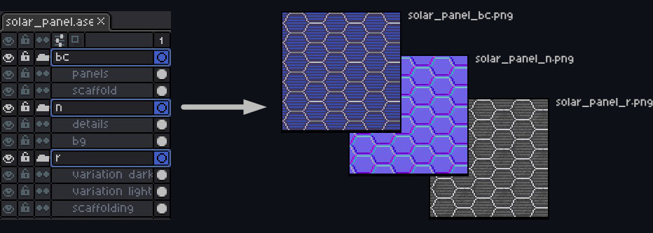
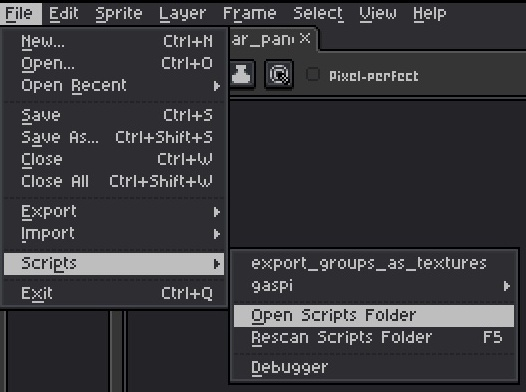

A collection place for any Aseprite scripts I write.

# How to use
Currently there is only one script: Exporting groups as texture layers.

The script works by hiding all groups, setting visibility on one by one and using the export sprite function. If the file is named "example" and the groups "bc" and "n", the resulting file names will be:
	example_bc.png
	example_n.png

Useful for working on texture sheets that have base color, normal or orm layers.

# Installation
Copy the contents of the scripts folder into Aseprite's scripts folder. To quickly find it go to File -> Scripts -> Open Scripts Folder

